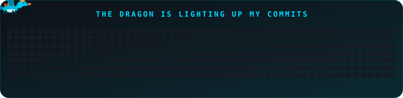

<!-- ============================================ -->
<!--   SUDHANSHU KUMAR PANDEY | GITHUB PROFILE    -->
<!--          MIDNIGHT CYAN · FOX EDITION         -->
<!-- ============================================ -->


<div align="center">


<br/>


</div>

<br/>

<!-- ================= ABOUT ================= -->

<div align="center">

## ⚡ ABOUT ME

</div>

<table align="center">
<tr>
<td width="55%" valign="top">

```ts
// sudhanshu.config.ts
export const sudhanshu = {
  education : "BE · Computer Science & Engineering",
  role      : "AI & Full-Stack Developer",
  focus     : "Data Science",
  location  : "India 🇮🇳",
  building  : ["ResQ AI", "FoodWise",
               "Tribal Scholarship", "Exam Guardrail"],
  philosophy: "Build useful things. Keep learning.",
  status    : "🟢 shipping new stuff",
};
```

</td>
<td width="45%" valign="top">

🎓 &nbsp;Pursuing **BE in CSE**<br/><br/>
🧠 &nbsp;**AI · Data Science · Full-Stack**<br/><br/>
🚀 &nbsp;Building practical, real-world apps<br/><br/>
🤝 &nbsp;Hackathons & team projects<br/><br/>
🎯 &nbsp;Goal: impactful, scalable, intelligent products<br/><br/>
⚡ &nbsp;Always learning, building, improving

</td>
</tr>
</table>

<br/>

<!-- ================= TECH STACK ================= -->

<div align="center">

## 🛠️ TECH ARSENAL

<table>
<tr><td align="center"><b>🔤 Languages</b></td>
<td></td></tr>
<tr><td align="center"><b>🎨 Frontend</b></td>
<td></td></tr>
<tr><td align="center"><b>⚙️ Backend & DB</b></td>
<td></td></tr>
<tr><td align="center"><b>🧰 Tools</b></td>
<td></td></tr>
</table>

</div>

<br/>

<!-- ================= STATS ================= -->

<div align="center">

## 📊 GITHUB STATS


<br/><br/>


<br/><br/>

## 🔥 STREAK


<br/><br/>


<!-- ================= FOX ================= -->

<div align="center">

## 🦊 MY CONTRIBUTION DRAGON



</div>

<br/>

<!-- ================= PROJECTS ================= -->

<div align="center">

## 🚀 FEATURED PROJECTS

</div>

<table>
<tr>
<td width="50%" valign="top">

<h3>🚨 ResQ AI</h3>
<p><b>AI-Powered Emergency First-Response Platform</b></p>
<p>Offline-first emergency response platform with one-tap SOS, support for 12+ Indian languages, CPR metronome, nearby emergency services and AI-assisted visual triage.</p>
<p>


</p>
<p>
<a href="https://github.com/Sudhanshu-22-11/ResQ-AI"></a>
</p>

</td>
<td width="50%" valign="top">

<h3>🌱 FoodWise</h3>
<p><b>AI-Powered Food Waste Reduction Platform</b></p>
<p>A modern food platform focused on reducing food waste through technology-driven food management, smart workflows and a scalable full-stack architecture.</p>
<p>


</p>
<p>
<a href="https://github.com/Sudhanshu-22-11/FoodWise"></a>
<a href="https://food-wise-puce.vercel.app"></a>
</p>

</td>
</tr>
<tr>
<td width="50%" valign="top">

<h3>🎓 Unified Tribal Scholarship</h3>
<p><b>Smart India Hackathon 2026 — Scholarship Platform</b></p>
<p>Unified scholarship dashboard (Ministry of Tribal Affairs concept) with rule-based eligibility, document wallet, verification matrix, JAGO AI assistant, gap detection and application/DBT tracking.</p>
<p>


</p>
<p>
<a href="https://github.com/Sudhanshu-22-11/sih-unified-tribal-scholarship"></a>
</p>

</td>
<td width="50%" valign="top">

<h3>🛡️ Exam Guardrail</h3>
<p><b>Integrity-First Exam Monitoring System</b></p>
<p>Team BrainBytes project: an integrity-first exam monitoring system with a web interface and server-side architecture for secure assessment workflows.</p>
<p>


</p>
<p>
<a href="https://github.com/Sudhanshu-22-11/Exam-Guardrail"></a>
</p>

</td>
</tr>
</table>

<br/>

<!-- ================= CONNECT ================= -->

<div align="center">

## 🌐 LET'S CONNECT

<a href="https://github.com/Sudhanshu-22-11"></a>
<a href="YOUR_LINKEDIN_URL"></a>
<a href="YOUR_INSTAGRAM_URL"></a>

<br/><br/>

### 💭 Developer Mindset

*"Great things are built one line of code at a time."*

**Code. Create. Repeat.** 🦊

⭐ Thanks for visiting my profile!

</div>


